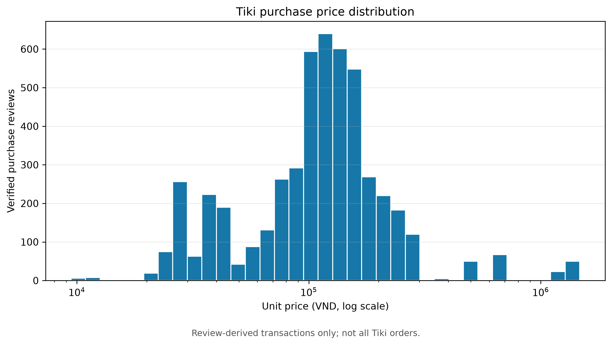
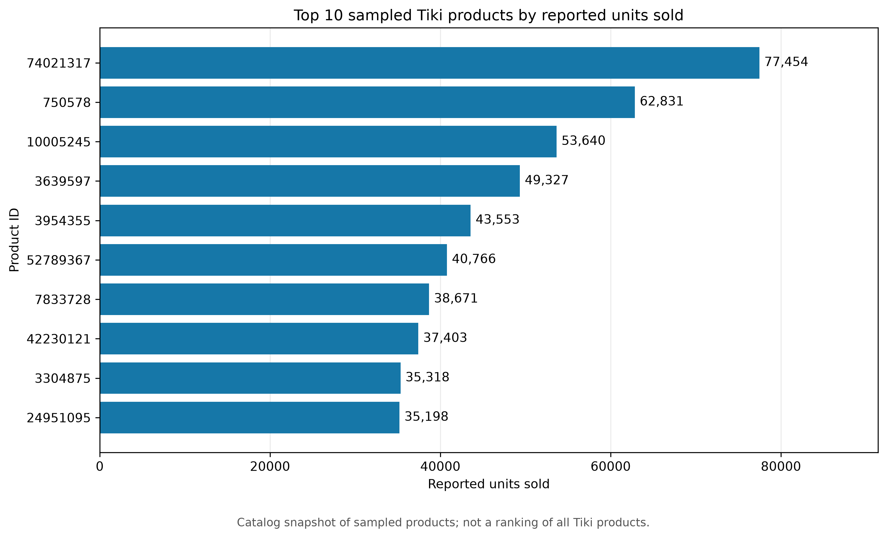
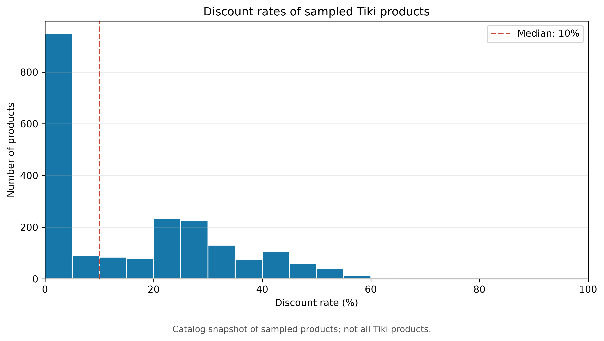
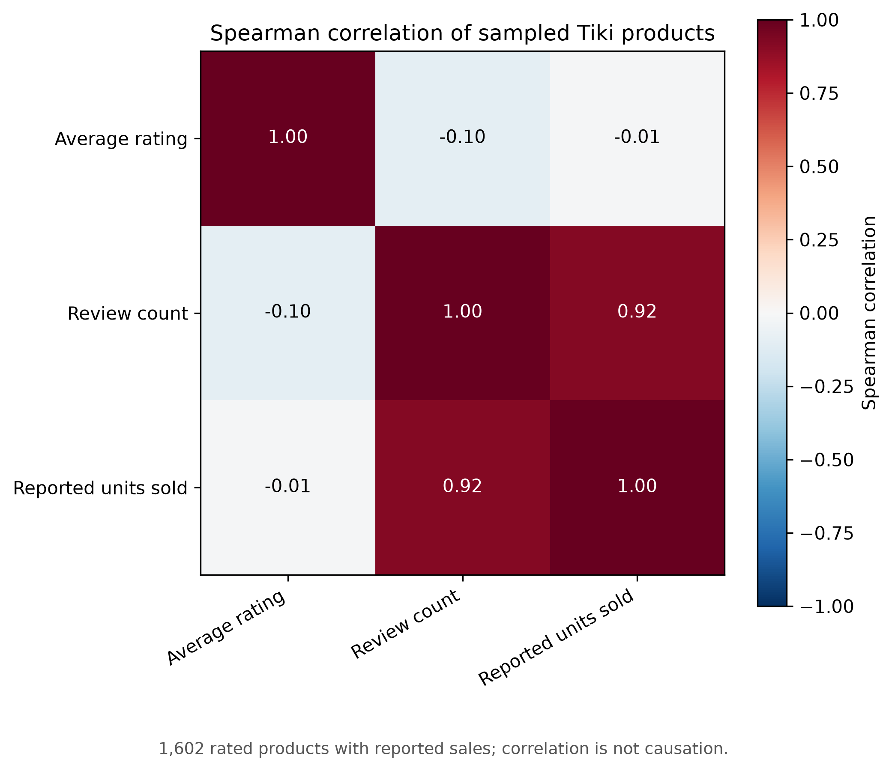
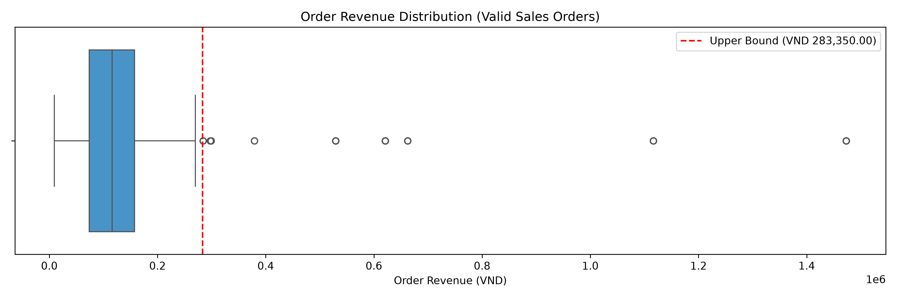

# Tiki EDA Report

## 1. Scope and sources

This analysis uses `data/raw/tiki/all_products.json` (2,100 sampled products),
`data/raw/tiki/all_reviews.json` (5,031 reviews), and
`data/processed/cleaned_tiki.csv` (5,026 verified-review purchase proxies).
The cleaned data covers 140 products with collected verified reviews.

One verified review is treated as one observed purchase. This dataset does
not contain all Tiki orders or customers.

## 2. Findings

### Purchase price distribution

The median `UnitPrice` is **116,250 VND**; observed values range from
**9,440 to 1,473,000 VND**. A logarithmic price axis shows the spread across
the 5,026 review-derived transactions.

### Top products by reported units sold

Among the sampled catalog products, product ID **74021317** has the highest
reported `quantity_sold.value`: **77,454 units**. This is a catalog snapshot,
not a ranking of every product on Tiki.

Ranking products by `Quantity` in `cleaned_tiki.csv` would be misleading:
the scraper collected at most **50 reviews per product**, and **73 of the
140 reviewed products** reached that cap.

### Discounts

The median catalog `discount_rate` is **10%**. **859 of 2,100 products
(40.9%)** have a recorded discount rate of 0%; the highest recorded rate
is **70%**.

### Ratings, reviews and reported sales

For **1,602 products** with a positive rating, review count and reported
units sold, Spearman correlation is **0.92** between `review_count` and
`quantity_sold.value`. Correlation between `rating_average` and reported
units sold is approximately **−0.01**. Products with rating 0 and review
count 0 were excluded because they are unrated, not necessarily poorly rated.
These associations do not establish causation.

### Order-level IQR flags

The upper revenue bound is **283,350 VND**. **241 of 5,026 observed orders
(4.8%)** exceed it. All transactions have `Quantity = 1`, so there are
no quantity anomalies. Flagged records remain in the dataset.

## 3. Method and interpretation limits

- `src/tiki_eda.py` produces the price, product, discount and correlation
  charts. `src/anomaly_detector.py` produces the order revenue boxplot.
- `InvoiceDate` is the **review creation timestamp**, used as a proxy for
  purchase time. `UnitPrice` is the **catalog price at collection time**,
  not the historical checkout price. Consequently, Tiki Revenue and RFM
  Monetary are proxies rather than audited sales or customer spend.
- The scraper sampled products and capped reviews per product. The observed
  product and customer distributions cannot be generalized to the whole
  Tiki marketplace.
- `quantity_sold.value`, rating, review count and discount rate are catalog
  snapshot fields. They may describe a different point in time from an
  individual review.
- The analysis is descriptive. IQR flags do not imply fraud, and correlation
  does not imply causation.

## 4. Recommendations

1. Inspect the 241 flagged orders for data quality and unusual catalog prices.
2. Use RFM and EDA findings as hypotheses about the reviewed sample only.
3. Obtain full order records, purchase timestamps and historical checkout
   prices before making marketplace-wide or customer-targeting decisions.